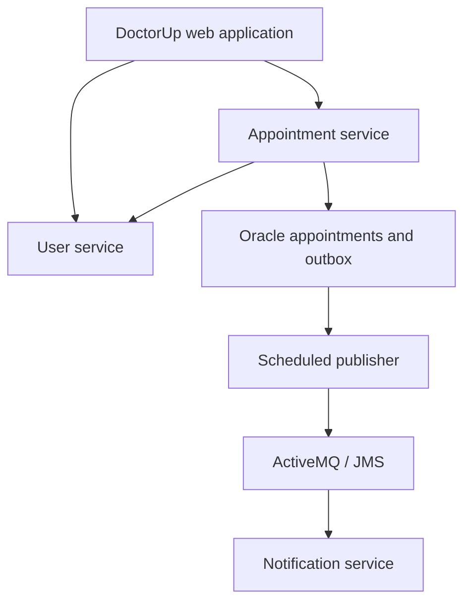

# DoctorUp — Appointment Booking Platform

A Java / Spring Boot project for authenticated appointment booking, doctor approvals, and asynchronous notification workflows.

## Features

- Patient and doctor registration/login flows.
- Appointment requests with pending, approved, and rejected states.
- Patient and doctor dashboards rendered with Thymeleaf.
- JWT authentication, REST communication, and Eureka service discovery.
- UserService refactoring and ActiveMQ/JMS notification work on the refactoring branch.

## Choose the right branch

The default `main` branch contains Patient, Doctor, AuthService, Appointment, DoctorUp, and EurekaServer modules.

The [RefactoringServices branch](https://github.com/Shivashia/AppointmentBooking_DS/tree/RefactoringServices) adds UserService, NotificationService, and transactional-outbox work. Legacy service directories remain there; it is an evolving implementation.

## Refactoring architecture



Eureka provides service discovery. Appointment creation writes the appointment and outbox event within a Spring transaction. A scheduler publishes new events through JMS; a consumer renders notification emails.

## Stack

Java, Spring Boot, Spring Security, JWT, JPA, Oracle, Eureka, Thymeleaf, Maven, ActiveMQ/JMS.

## Run locally

Requires a JDK compatible with the selected module POM, Oracle with an application schema, and the included Maven wrappers. The notification implementation also needs ActiveMQ and SMTP configuration.

1. Clone the repository and select the desired branch.
2. Configure local datasource, JWT, broker, and SMTP settings. Use dedicated local credentials rather than reusing committed development values.
3. Start EurekaServer, required backend modules, and DoctorUp in separate terminals. For the refactoring path, include UserService and NotificationService.
4. From each module directory, run:

```powershell
.\mvnw.cmd spring-boot:run
```

On macOS/Linux use `./mvnw spring-boot:run`. The checked configuration uses Eureka at `http://localhost:8761` and DoctorUp at `http://localhost:8084`. Check the selected branch for the other service ports.

## Delivery semantics and validation

The current outbox publisher marks failures as FAILED; automatic retries and crash recovery remain further work. Approval/rejection event publication and duplicate-message handling need verification before claiming notifications for every transition or exactly-once delivery.

Suggested checks: registration/login, booking, approval/rejection, appointment/outbox persistence, JMS publication, and email consumption. Test dependency outages and repeated messages separately. No verified one-command deployment, throughput benchmark, or production-readiness claim is made.
